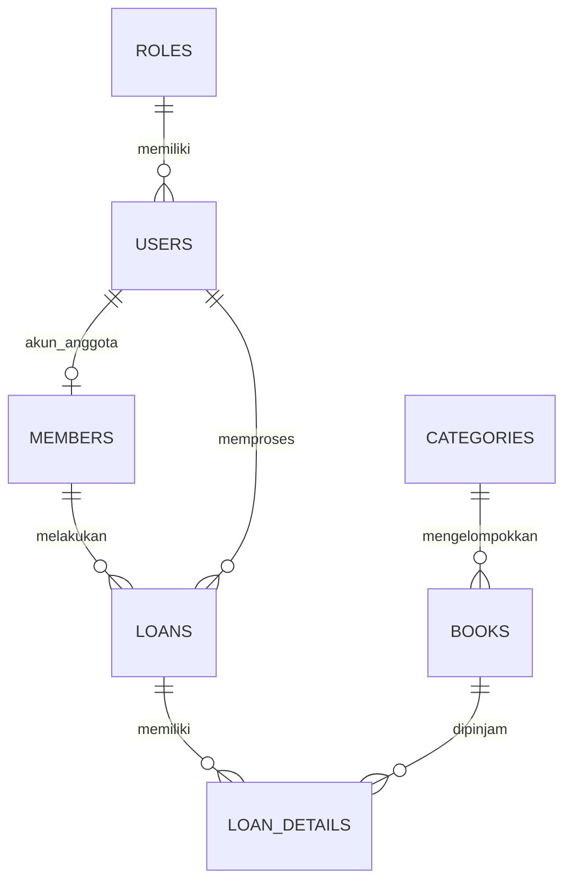

# Dokumen Analisis SIPER

## 1. Masalah dan tujuan
Perpustakaan membutuhkan pencatatan katalog, anggota, peminjaman, pengembalian, dan laporan yang terhubung. SIPER mengurangi pencatatan terpisah dan membantu petugas memantau stok.

## 2. Proses bisnis
1. Pengguna login dan sistem membaca role.
2. Admin mengelola kategori dan buku.
3. Petugas mendaftarkan anggota.
4. Petugas memilih anggota dan buku, mengisi jumlah serta tanggal.
5. Backend memvalidasi identitas, stok, jumlah, dan tanggal.
6. Database menyimpan transaksi dan detail dalam satu transaksi SQL; stok berkurang.
7. Saat pengembalian, sistem memeriksa status transaksi, memperbarui status, dan menambah stok.
8. Laporan menggabungkan transaksi, anggota, buku, dan petugas melalui JOIN.
9. Anggota hanya melihat riwayat yang terkait dengan akun miliknya.

## 3. Role dan hak akses
| Role | Hak akses | Larangan |
|---|---|---|
| ADMIN | Dashboard, katalog, tambah buku, anggota, peminjaman, pengembalian, laporan | Tidak ada pengelolaan role melalui UI pada versi praktikum |
| PETUGAS | Lihat buku, kelola anggota, peminjaman, pengembalian, laporan | Tidak boleh menambah buku |
| ANGGOTA | Lihat katalog dan riwayat sendiri | Tidak boleh mengakses proses anggota/transaksi/laporan |

## 4. Aturan bisnis
- Username, kode anggota, ISBN, dan nama kategori unik.
- Nama anggota dan data wajib tidak boleh kosong.
- Email, jika diisi, harus berformat email.
- Jumlah pinjam 1–5.
- Tanggal jatuh tempo harus setelah tanggal pinjam.
- Anggota dan buku harus benar-benar tersedia di database.
- Stok tidak boleh menjadi negatif.
- Peminjaman hanya berhasil jika stok mencukupi.
- Pengembalian hanya dapat dilakukan sekali pada transaksi berstatus DIPINJAM.
- Perubahan status dan stok dilakukan dalam transaksi database.
- Tarif/denda tidak menjadi ruang lingkup versi ini.

## 5. ERD tekstual

## 6. Kamus data ringkas
| Tabel | Kolom penting | Keterangan |
|---|---|---|
| roles | id PK, name UNIQUE | Master role |
| users | id PK, role_id FK, username UNIQUE, password_hash, is_active | Akun login |
| categories | id PK, name UNIQUE | Kategori buku |
| books | id PK, category_id FK, isbn UNIQUE, title, author, stock | Data katalog dan stok |
| members | id PK, user_id FK nullable UNIQUE, member_code UNIQUE, name, email, phone | Data anggota |
| loans | id PK, member_id FK, user_id FK, loan_code UNIQUE, loan_date, due_date, returned_at, status | Header transaksi |
| loan_details | id PK, loan_id FK, book_id FK, quantity | Detail buku dalam transaksi |

## 7. Alur integrasi modul
- Katalog memakai `categories` untuk menampilkan nama kategori.
- Form peminjaman memakai data `members` dan `books`.
- Simpan peminjaman menulis `loans` dan `loan_details`, lalu mengurangi `books.stock`.
- Pengembalian membaca `loan_details`, mengubah `loans.status`, lalu menambah `books.stock`.
- Laporan JOIN `loans`, `members`, `users`, `loan_details`, dan `books`.
